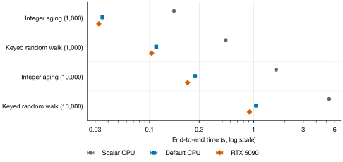

# AMBER (Agent-based Modeling with Blazingly Efficient Records)

[](https://github.com/a11to1n3/AMBER/actions/workflows/ci.yml)
[](https://codecov.io/gh/a11to1n3/AMBER)
[](https://www.python.org/downloads/)
[](https://pypi.org/project/ambr/)
[](https://opensource.org/licenses/BSD-3-Clause)

AMBER is a Python framework for agent-based modeling that uses Polars for
efficient columnar population state. Write ordinary Python agent methods and
choose CPU or NVIDIA GPU at the run call. AMBER 0.6.0 automatically batches
supported rules and uses the Python loop for other rules. Use `Experiment`,
`ParallelRunner`, or `GPUEnsembleRunner` to run multiple simulations in parallel.

Install [AMBER 0.6.0](https://pypi.org/project/ambr/0.6.0/) with
`python -m pip install --upgrade ambr`. See the
[release notes](https://github.com/a11to1n3/AMBER/releases/tag/v0.6.0)
and the [same-model CPU and GPU example](#automatic-cpu-and-gpu-batching).

## 🚀 Performance

AMBER stores population state in Polars columns. CPU and GPU runs automatically
batch eligible agent methods that add or subtract integer constants from an
agent's own fields. A simple condition on that agent's own state can select
which agents update. Other agent methods use the Python loop. Models can also
write bulk updates directly with `agents.where(...)`, `agents.at[ids]`, or
`scatter_add`. Compatible bulk code can run on a GPU with `model.gpu().run()`.

### GPU requirements

| Claim | Requires |
|-------|----------|
| CPU bulk updates | Column operations with `pip install ambr` (optional `ambr[perf]` / Numba) |
| CUDA execution | **NVIDIA GPU + CuPy**. Install a CuPy wheel that matches your CUDA environment. |
| Apple Silicon | CPU execution |

Check available execution paths on your machine.

```python
import ambr as am
am.print_status()
print(am.recommend(1_000_000))
```

Run these checks on a CUDA host to verify the GPU paths.

```bash
python scripts/run_gpu_claims.py          # full (incl. large-N)
python scripts/run_gpu_claims.py --quick  # fast smoke
```

### AMBER 0.6.0 automatic batching benchmark

The benchmark used the same ordinary agent methods on scalar CPU
(`run(auto_batch=False)`), default CPU (`run()`), and an RTX 5090
(`gpu().run()`). Each run took 20 steps. Median end-to-end time includes
model construction, setup, steps, the end hook, and exporting the final agent
table to the host. Each median uses six timed runs after one warm-up.

| Workload | Agents | Scalar CPU | Default CPU | RTX 5090 |
| --- | ---: | ---: | ---: | ---: |
| Integer aging | 1,000 | 0.172 s | 0.035 s | 0.033 s |
| Keyed random walk | 1,000 | 0.539 s | 0.116 s | 0.105 s |
| Integer aging | 10,000 | 1.645 s | 0.274 s | 0.232 s |
| Keyed random walk | 10,000 | 5.317 s | 1.058 s | 0.912 s |

Final agent tables matched in all 84 runs, including warm-ups. Default CPU
and GPU batched all 20 sweeps in each run. The measurements use the
`7d13fca` release candidate, whose runtime source matches the `v0.6.0`
build. [Raw samples and environment](benchmarks/results/automatic_batching_0_6_0.json)



Points show the median and whiskers show the minimum and maximum of six timed
runs for one seed per case. The ranges fit within the markers at this scale.

### Historical GPU comparison at 10 million agents

This separate benchmark uses explicit workload-specific GPU implementations
from the July snapshot based on `cdb4f135`.
[Raw results](benchmarks/results/benchmark_results_snapshot_correct_10run_10m.json) ·
[Summary](benchmarks/results/summary_table_snapshot_correct_10run_10m.md)

**Protocol:** NVIDIA RTX 5090; 10M agents; 50 steps; **10 runs** retained
(no outlier deletion); one untimed warm-up per cell; timed scope =
construct + setup + step loop + result assembly. AMBER GPU synchronizes
after the run; FLAME GPU 2 returns at a simulation-complete boundary.
This is an **implementation comparison** under that protocol — not a claim
of byte-identical dynamics across frameworks.

**AMBER (GPU) vs FLAME GPU 2 at 10M agents** (mean wall-clock):

| Model | AMBER (GPU) | FLAME GPU 2 | Speedup (FLAME / AMBER) |
|---|---:|---:|---:|
| Wealth | **94 ms** | 194 ms | ~2.05× |
| Random walk | **80 ms** | 161 ms | ~2.00× |
| SIR (cell-list) | **2.08 s** | 3.68 s | ~1.77× |
| Schelling | **295 ms** | 18.7 s | ~63× (setup-inclusive; **exploratory**) |

- **Wealth / walk / SIR** are the comparable headline class (~1.8–2.1×).
- **Schelling** includes heavy Python-side setup inside the timed region for
  the FLAME harness; do not treat ~63× as a pure step-kernel speedup.
- Multi-framework scale-out charts (Mesa, mesa-frames, Agents.jl, …) are
  **exploratory** and live under
  [`benchmarks/results/`](benchmarks/results/); some cells OOM or hit
  budgets — missing cells are not zeros.
- [Benchmark runner](benchmarks/run_all_frameworks.py) ·
  [Correctness checks](benchmarks/correctness_check.py) ·
  [Protocol details](benchmarks/README.md)

The [archived scaling chart](benchmarks/README.md#exploratory-multi-framework-sweep-historical)
shows a separate exploratory sweep over 1,000 to 10 million agents.

**Benchmark API:** the vectorized benchmark models implement `step_vectorized()`
and run with `.cpu(mode="vectorized")` or `.gpu()`. Private
optimized GPU loops require an explicit
`approve_fast_path(evidence)` label (caller-attested provenance; AMBER
checks presence of the label, not the evidence content) and
`contract="off"` — see [`docs/going_faster.rst`](https://ambr.readthedocs.io/en/latest/going_faster.html).

The 0.6.0 release workflow passed its Linux, macOS, and Windows CPU
matrix. Native CUDA verification ran separately on an RTX 5090.
[Release workflow run](https://github.com/a11to1n3/AMBER/actions/runs/44301675006)

## 🚀 Quick Start

Write a model with ordinary `setup()` and `step()` methods. Choose execution
when you run it. Models can also supply explicit column operations.

**AgentPy-shaped (method broadcast, `AgentList`):**

```python
import ambr as am

class WealthAgent(am.Agent):
    def setup(self):
        self.wealth = 1
    def transfer(self):
        if self.wealth > 0:
            other = self.model.agents.by_id(self.model.agents.random())
            other.wealth += 1
            self.wealth -= 1

class WealthModel(am.Model):
    def setup(self):
        self.agents = am.AgentList(self, self.p.n, WealthAgent)
    def step(self):
        self.agents.transfer()
    def update(self):
        self.record_model('total', int(self.agents.wealth.sum()))

results = WealthModel({'n': 50, 'steps': 20, 'seed': 1}).run()
print(results.model.tail(3).to_dicts())      # also results['model']
print(results.agents.head().to_dicts())
print(results.info.get("mode"), results.info.get("execution_lane"))
```

### Automatic CPU and GPU batching

This AMBER 0.6.0 example starts with 1,000 people at age zero. Half are active.
In each of three steps, a person ages by one if active.

```python
import ambr as am

class Person(am.Agent):
    def setup(self):
        self.age = 0
        self.active = self.id % 2 == 0

    def step(self):
        if self.active:
            self.age += 1

class PopulationModel(am.Model):
    def setup(self):
        self.add_agents(self.p.n, agent_class=Person)

    def step(self):
        self.agents.step()

params = {"n": 1_000, "steps": 3}
results = PopulationModel(params).run()
print(results.info["auto_batch"])
```

Choose a run call for the same model declaration.

| Run call | What happens behind it |
| --- | --- |
| `PopulationModel(params).run()` | AMBER recognizes the rule and uses Polars to select and increment the active rows on CPU. |
| `PopulationModel(params).vectorize().run()` | Selects vectorized mode on the current device. On CPU, this is the same mode as the default run. |
| `PopulationModel(params).gpu().run()` | AMBER uses CuPy on NVIDIA CUDA to apply the rule. It keeps the batched columns on the device across steps until host code needs them. |
| `PopulationModel(params).run(auto_batch=False)` | AMBER calls each agent's Python method. This is the reference run for comparing results. |

Automatic batching handles supported integer additions and subtractions on an
agent's own fields in sequential calls over a sufficiently large group of
agents of one class. A condition can select agents using their own fields or
a comparison such as `self.draw("move", index=2) < 0.45`. AMBER generates
the same keyed draws on the host for CPU and GPU runs. On GPU, it uploads the
selection mask and applies the updates to device columns. Rules involving other
agents, shared random draws, custom attribute access, or unsupported types use
the Python loop. Contract checking also uses the Python loop. The aging example records
three batches and 3,000 agent calls replaced. After three steps, the active
people are age 3 and the others are age 0.
[Automatic batching implementation](src/ambr/_auto_batch.py)

Bounded random walks also batch when their positions are stored as Float64.
This agent uses the same rule on CPU and GPU. Its two axes use independent draw keys.

```python
import ambr as am


class Walker(am.Agent):
    def step(self):
        self.x = max(0.0, min(100.0, self.x + (self.draw("x") * 2.0 - 1.0)))
        self.y = max(0.0, min(100.0, self.y + (self.draw("y") * 2.0 - 1.0)))


class Walk(am.Model):
    def setup(self):
        self.add_agents(1_000, agent_class=Walker, x=50.0, y=50.0)

    def step(self):
        self.agents.step()


model = Walk({"seed": 42, "steps": 50})
results = (model.gpu() if am.GPU_AVAILABLE else model.vectorize()).run()
```

#### The same rule in other frameworks

Each example below implements the same aging rule for one of the peers in the
[benchmark runner](benchmarks/run_all_frameworks.py).

<details>
<summary>AgentPy</summary>

```python
import agentpy as ap

class Person(ap.Agent):
    def setup(self):
        self.age = 0
        self.active = self.id % 2 == 0

    def step(self):
        if self.active:
            self.age += 1

class Population(ap.Model):
    def setup(self):
        self.agents = ap.AgentList(self, self.p.n, Person)

    def step(self):
        self.agents.step()

Population({"n": 1_000, "steps": 3}).run()
```

`AgentList` broadcasts the call through `AttrIter`, which invokes each agent's
bound method in Python. The one broadcast dispatches 1,000 Python calls per
step. [AgentPy sequence source](https://agentpy.readthedocs.io/en/stable/_modules/agentpy/sequences.html)

</details>

<details>
<summary>Mesa</summary>

```python
import mesa

class Person(mesa.Agent):
    def __init__(self, model):
        super().__init__(model)
        self.age = 0
        self.active = self.unique_id % 2 == 0

    def step(self):
        if self.active:
            self.age += 1

class Population(mesa.Model):
    def __init__(self, n):
        super().__init__()
        for _ in range(n):
            Person(self)

    def step(self):
        self.agents.do("step")

model = Population(1_000)
for _ in range(3):
    model.step()
```

Mesa registers the agents in the model's `AgentSet`. `do("step")` invokes one
Python method per object in the current order. `shuffle_do("step")` selects a
random activation order. [Mesa AgentSet API](https://mesa.readthedocs.io/stable/apis/agentset.html)

</details>

<details>
<summary>mesa-frames</summary>

This example uses the same `mesa-frames==0.1.0a0` API as the benchmark adapter.

```python
import polars as pl
from mesa_frames import AgentSetPolars, ModelDF

class People(AgentSetPolars):
    def step(self):
        ages = self.agents["age"] + self.agents["active"].cast(pl.Int64)
        self.set("age", ages.to_numpy())

class Population(ModelDF):
    def __init__(self, n):
        super().__init__()
        people = People(self)
        people.add(pl.DataFrame({
            "unique_id": list(range(n)),
            "age": [0] * n,
            "active": [i % 2 == 0 for i in range(n)],
        }))
        self.agents += people

    def step(self):
        self.agents.do("step")

model = Population(1_000)
for _ in range(3):
    model.step()
```

Each person is a row in a Polars table. The model calls `step()` once on the
set. Polars computes the updated age column and `set()` writes it back.
[mesa-frames 0.1.0a0](https://pypi.org/project/mesa-frames/0.1.0a0/),
[benchmark adapter](benchmarks/models/mesa_frames_models.py)

</details>

<details>
<summary>Melodie</summary>

```python
import Melodie

class Person(Melodie.Agent):
    def setup(self):
        self.age = 0
        self.active = self.id % 2 == 0

    def step(self):
        if self.active:
            self.age += 1

class Population(Melodie.Model):
    def create(self):
        self.people = self.create_agent_list(Person)

    def setup(self):
        self.people.setup_agents(1_000)

    def run(self):
        for _ in self.iterator(3):
            for person in self.people:
                person.step()
```

The Melodie simulator supplies the configuration and scenario and calls
`create()`, `setup()`, and `run()`. The period loop invokes each Python agent
object's method. [Melodie model lifecycle](https://abm4all.github.io/Melodie/html/api/model.html)

</details>

<details>
<summary>SimPy</summary>

```python
import simpy

def age_person(env, person):
    for _ in range(3):
        yield env.timeout(1)
        if person["active"]:
            person["age"] += 1

env = simpy.Environment()
people = [{"age": 0, "active": i % 2 == 0} for i in range(1_000)]
for person in people:
    env.process(age_person(env, person))
env.run()
```

Each person is a generator process. SimPy puts its timeout on an event queue
and resumes the process when its event is due. Events for the same time are
processed one by one. [SimPy time and scheduling](https://simpy.readthedocs.io/en/stable/topical_guides/time_and_scheduling.html)

</details>

<details>
<summary>Agents.jl</summary>

```julia
using Agents

@agent struct Person(NoSpaceAgent)
    age::Int
    active::Bool
end

function age_person!(person, model)
    if person.active
        person.age += 1
    end
end

model = StandardABM(Person; agent_step! = age_person!)
for i in 0:999
    add_agent!(model, 0, iseven(i))
end
step!(model, 3)
```

The scheduler calls `agent_step!` once per scheduled agent. Julia specializes
the typed code and compiles it to native CPU code.
[Agents.jl API](https://juliadynamics.github.io/Agents.jl/stable/api/),
[Julia compiler specialization](https://docs.julialang.org/en/v1/manual/performance-tips/)

</details>

<details>
<summary>FLAME GPU 2</summary>

```python
import pyflamegpu as fg

rule = """
FLAMEGPU_AGENT_FUNCTION(age_person, flamegpu::MessageNone, flamegpu::MessageNone) {
    if (FLAMEGPU->getVariable<int>("active")) {
        int age = FLAMEGPU->getVariable<int>("age");
        FLAMEGPU->setVariable<int>("age", age + 1);
    }
    return flamegpu::ALIVE;
}
"""

model = fg.ModelDescription("population")
person = model.newAgent("person")
person.newVariableInt("age", 0)
person.newVariableInt("active", 0)
model.newLayer().addAgentFunction(person.newRTCFunction("age_person", rule))

people = fg.AgentVector(person, 1_000)
for i in range(0, 1_000, 2):
    people[i].setVariableInt("active", 1)

sim = fg.CUDASimulation(model)
sim.SimulationConfig().steps = 3
sim.setPopulationData(people)
sim.simulate()
```

Python declares the agent variables, initializes the population, and registers
the agent function in a layer. FLAME GPU compiles the function at runtime and
executes it in parallel on CUDA. An experimental API also transpiles restricted,
decorated Python agent functions to C++.
[FLAME GPU agent functions](https://docs.flamegpu.com/guide/agent-functions/defining-agent-functions.html)

</details>

### Explicit column operations

```python
import ambr as am

class WealthModel(am.Model):
    model_reporters = {'total_wealth': lambda m: int(m.agents.wealth.sum())}

    def setup(self):
        self.add_agents(100, wealth=self.rng.integers(1, 10, size=100))

    def step_vectorized(self):
        # View API: where / column assign / scatter_add (not agents.array mutate).
        # agents.array(...) returns a read-only snapshot on the CPU Polars path.
        donors = self.agents.where(self.agents.wealth > 0)
        donors.wealth -= 1
        recipients = self.rng.choice(self.agents.ids.to_numpy(), size=len(donors))
        self.agents.at[recipients].scatter_add(wealth=1)

# Fluent placement: device + optional mode; run(mode=...) still overrides.
# GPU when NVIDIA+CuPy available; otherwise CPU vectorized.
_m = WealthModel({'steps': 100, 'seed': 42, 'show_progress': False})
results = _m.gpu().run() if am.GPU_AVAILABLE else _m.cpu(mode="vectorized").run()
print(results.info)
print(results.model.tail(5).to_dicts())
print(results.agents.head(10).to_dicts())
```

Coming from AgentPy? See [`docs/from_agentpy.rst`](https://ambr.readthedocs.io/en/latest/from_agentpy.html).

**Going faster / GPU** — same `Model` class; pick placement and lane hooks (see
[`docs/going_faster.rst`](https://ambr.readthedocs.io/en/latest/going_faster.html)):

```python
import ambr as am
am.print_status()                 # GPU? which lane?
print(am.recommend(1_000_000))  # one-line suggestion

# Same view-API model shape as the vectorized quickstart above
class WealthModel(am.Model):
    def setup(self):
        n = int(self.p.get("n", 100_000))
        self.add_agents(n, wealth=1)
    def step_vectorized(self):
        donors = self.agents.where(self.agents.wealth > 0)
        donors.wealth -= 1
        self.agents.at[
            self.rng.choice(self.agents.ids.to_numpy(), size=len(donors))
        ].scatter_add(wealth=1)

# Native path: step_vectorized + .gpu() when NVIDIA+CuPy are available
model = WealthModel({"n": 100_000, "steps": 50, "seed": 0, "show_progress": False})
if am.GPU_AVAILABLE:
    results = model.gpu().run()
else:
    results = model.cpu(mode="vectorized").run()  # Mac / no-CUDA fallback
print(results.info)

# Array-kernel lane (CuPy if available, else NumPy) for pure array state:
class Drift(am.ArrayKernelModel):
    def init_state(self, xp, n, rng, p):
        return {"x": rng.random(n, dtype=xp.float32)}
    def step_state(self, xp, state, rng, p):
        state["x"] = state["x"] + 0.01
        return state
    def metrics(self, xp, state):
        return {"mean_x": float(am.to_host(state["x"].mean()))}

print(Drift({"n": 100_000, "steps": 20, "show_progress": False}).run().info)
```

`self.rng` is the canonical seeded RNG (a NumPy `Generator`); `self.random` is
the stdlib one. Both are seeded from the `seed` parameter. Progress printing is
off by default (`show_progress=True` to re-enable).

> **New in 0.5.0:** production-candidate. **Breaking / install:** matplotlib
> moved to `ambr[viz]`; scikit-optimize was removed and replaced by SMAC
> under `ambr[advanced]` (SMAC + ConfigSpace + scikit-learn). Python
> **3.10–3.13** only. **API:** `record_model` inside `step()` is kept;
> missing optimization metrics raise; SMAC defaults to `on_error='raise'`;
> `RunResults.save` uses a versioned manifest. Upgrade with
> `pip install -U 'ambr>=0.5.0'`. Full list:
> [CHANGELOG.md](https://github.com/a11to1n3/AMBER/blob/main/CHANGELOG.md).
>
> **0.4.7:** GPU claim script renamed to
> [`scripts/run_gpu_claims.py`](https://github.com/a11to1n3/AMBER/blob/main/scripts/run_gpu_claims.py);
> paper-campaign machine labels removed from user-facing docs.

## ⚡ Vectorized View API

The view API runs bulk operations on whole columns or selected rows:

```python
def step(self):
    # Bulk columnar reads/writes over the entire population
    self.agents.x = self.agents.x + self.rng.uniform(-1, 1, len(self.agents))

    # Filtered writes: only agents matching a condition
    infected = self.agents.where(self.agents.status == 1)
    infected.infection_time += 1

    # scatter_add: flow-of-resources with duplicate-id safety
    self.agents.at[[1, 1, 3]].scatter_add(wealth=1)  # agent 1 gets +2, agent 3 gets +1
```

## Canonical API

Legacy spellings emit a `DeprecationWarning` and are scheduled for removal in
**1.0**. Set `AMBER_SUPPRESS_DEPRECATIONS=1` to silence them in reproducibility runs.
Ordinary agent rules and explicit column operations both have batching paths.

| Task | Canonical | Legacy (deprecated → 1.0) |
|------|-----------|---------------------------|
| NumPy RNG | `self.rng` | `self.nprandom` |
| Device / run mode | `model.cpu(mode=...).run()` / `model.gpu().run()` | `run(backend=...)` |
| Record a model metric | `model_reporters = {...}` or `record_model(k, v)` | `record(k, v)` |
| Filter agents | `agents.where(expr)` / `agents[mask]` / `agents.at[ids]` | `agents.select(...)` |
| Per-agent write | `agent.col = v` | `agent.record(...)`, `agent.update_data(...)`, `update_agent_data` |
| Bulk / multi-column write | `agents.set(**cols)` or `view.col = …` | `agents.record` / `update_data`, `batch_update_agents`, `Population.batch_*` |
| Accumulate (duplicate ids) | `agents.at[ids].scatter_add(...)` | double ordinary writes in one step |
| Array kernels | `agents.borrow` / `agents.commit` (or `TensorLane`) | hand-maintained parallel NumPy buffers |
| Read agent objects | iterate `model.agents`, `agents.by_id(i)` | `agents.agents`, `agents.agent_ids` |
| Bulk numpy round-trip | `agents.numpy(...)` + `agents.set(...)` | `.to_numpy()` + per-column assign only |
| Typed parameters | `params = {'n': (int, 200)}`, then `self.p.n` | `int(self.p.get('n', 200))` |
| Grid wrap | `GridEnvironment(torus=True)` | `wrap=` / `.wrap` |
| Agent table assign | view / `_set_frame` | `population.data = ...` (setter warns) |

`update()` is a **pure hook** — overriding it no longer requires
`super().update()`. Declare `model_reporters` / `agent_reporters` for
declarative metrics, and set `record_initial = True` to capture a `t=0` row.
Agent attributes can hold mutable Python lists and dictionaries. After an
in-place edit, assign the container to the attribute to publish its updated
contents to the columnar store.

## 🔒 Snapshot-view contract

The snapshot-view contract checks instrumented reads and writes. `cert.clean`
means no monitored hazard was observed. `cert.conditional_guarantee` is
`"established"` when AMBER verifies order independence for a supported
CPU activation sweep.

```python
import ambr as am

class Person(am.Agent):
    def step(self):
        if self.draw("earn") < 0.25:
            self.wealth += 1

class WealthModel(am.Model):
    def setup(self):
        self.add_agents(50, agent_class=Person, wealth=1)

    def step(self):
        self.agents.step()

results = WealthModel({"steps": 20, "seed": 7}).run(contract="check")
cert = results["contract"][0]
assert cert.conditional_guarantee == "established"
print(cert.certification)
```

`check` records a `ContractCertificate` per step. `warn` also emits a warning per
violation. `raise` stops on the first error. Mode `off` disables the monitor.
The proof covers supported integer updates and exact, fixed-target integer
reductions for one sequential or shuffled sweep at its observed entry state.
`self.draw("earn")` gives the same uniform value for a given seed, step,
agent ID, and event. Use `index=` for multiple draws within one event.
Other rules and GPU runs receive `"not_established"` with a
`cert.certification_reason`. Separately written vectorized and GPU kernels
require reference comparisons.

For supported CPU and GPU sweeps, swapped-order replay can confirm a divergence
and restore the forward model state. A witness is inconclusive when a replay
cannot isolate the sweep or verify its random streams.

The monitor watches **two write paths** (and combinations):

* **Buffered (OOP)** — `agent.col = …` / queued cell writes
* **Lane / view** — `agents.col = …`, `agents.set(...)`, `borrow`/`commit`
* **Cross-path** — same column via both OOP and view in one step → `cross_path_write`
* **Mutable raw arrays** — `agents.array(...)` → `uncertified_mutable_borrow`

Ordinary view writes require unique target IDs. Use `scatter_add` or
`scatter_max` for repeated targets.

## 🎮 GPU backend & batched calibration

**Single-run (native):** call `model.gpu().run()` when NVIDIA+CuPy are available.
AMBER batches eligible ordinary agent rules on the GPU and also supports explicit
column updates. It uses `step_vectorized()` when provided, otherwise `step()` or
a standalone `step_oop()`. Numeric columns stay on the device until host access
or teardown. Contract modes use the
instrumented general path; private model-specific fast loops run only with
`contract="off"` **and** an explicit per-instance
`approve_fast_path(evidence)` declaration. The evidence string is a
caller-supplied provenance label, not something AMBER verifies. Without it,
`gpu().run()` uses the general path. Private loops bypass the monitor.

```python
import ambr as am

class WealthModel(am.Model):
    def setup(self):
        n = int(self.p.get("n", 1_000_000))
        self.add_agents(n, wealth=1)
    def step_vectorized(self):
        donors = self.agents.where(self.agents.wealth > 0)
        donors.wealth -= 1
        self.agents.at[
            self.rng.choice(self.agents.ids.to_numpy(), size=len(donors))
        ].scatter_add(wealth=1)

# Requires NVIDIA + CuPy. On CPU-only machines use .cpu(mode="vectorized").
model = WealthModel({"n": 1_000_000, "steps": 50, "seed": 0, "show_progress": False})
results = model.gpu().run() if am.GPU_AVAILABLE else model.cpu(mode="vectorized").run()
print(results.info)
# Private fast loop (only if the model defines one; evidence is not verified):
# model.approve_fast_path("my-bench-label").gpu().run(contract="off")
```

**Many short runs (calibration):** the *ensemble* axis (`B` simulations × `N`
agents) batches into one device pass — the natural fit when you evaluate
thousands of small replicate runs:

```python
import numpy as np
import ambr as am
from ambr.gpu_ensemble import GPUEnsembleRunner, BatchedWellMixedSIR

# Needs NVIDIA + CuPy. B parameter sets in one (B, N) GPU pass.
B = 4
betas = np.full(B, 0.3)
gammas = np.full(B, 0.1)
i0 = np.full(B, 0.01)
runner = GPUEnsembleRunner(BatchedWellMixedSIR())
if am.GPU_AVAILABLE:
    traj = runner.run(
        n_agents=10_000, steps=30,
        params={"beta": betas, "gamma": gammas, "i0_frac": i0},
    )  # -> {metric: (B, steps)}
    print({k: v.shape for k, v in traj.items()})
else:
    print("GPU ensemble requires NVIDIA + CuPy; skip on this host")
# Optional SMAC loop: smac_batch_calibrate(BatchedWellMixedSIR(), bounds, loss_fn, ...)
# (needs pip install 'ambr[advanced]')
```

`ambr.gpu` provides the array-module abstraction (`get_array_module`, `to_device`,
`to_host`) and falls back to NumPy when CuPy is unavailable. Requires **NVIDIA
GPU + CuPy** (not Apple Metal/MPS).

## 🔬 Optimization

AMBER includes powerful optimization capabilities for parameter tuning:

```python
import ambr as am
from ambr.optimization import ParameterSpace, grid_search

class MyModel(am.Model):
    def setup(self):
        n = int(self.p.get("agents", 50))
        self.add_agents(n, wealth=int(self.p.get("initial_value", 1)))
    def step_vectorized(self):
        donors = self.agents.where(self.agents.wealth > 0)
        donors.wealth -= 1
        self.agents.at[
            self.rng.choice(self.agents.ids.to_numpy(), size=len(donors))
        ].scatter_add(wealth=1)
    def update(self):
        self.record_model("total_wealth", int(self.agents.wealth.sum()))

parameter_space = ParameterSpace({
    "agents": [20, 40],
    "initial_value": [1, 5],
    "steps": 10,
    "seed": 0,
    "show_progress": False,
})
results = grid_search(MyModel, parameter_space, metric="total_wealth", minimize=False)
best_params = results[0]["parameters"]
print(best_params, results[0]["objective"])
```

Beyond `grid_search`, AMBER ships `random_search`, `bayesian_optimization`
(SMAC RandomForest surrogate; GP is unsupported), and `SMACOptimizer`
(same RandomForest stack) — plus the GPU batched ensemble above for
derivative-free calibration at scale.

## 📦 Installation

The examples on this page use the published AMBER 0.6.0 release.

```bash
python -m pip install --upgrade ambr

# Optional extras
pip install 'ambr[perf]'              # Numba CPU scatter (recommended on Mac)
pip install 'ambr[viz]'               # matplotlib plot helpers
pip install 'ambr[advanced]'          # SMAC optimization
pip install 'ambr[advanced,viz]'      # SMAC + matplotlib (example plots)
```

The `ambr[gpu]` extra installs the generic CuPy package. To use a prebuilt
CUDA wheel, install `ambr` and the matching CuPy distribution. For example,
use `python -m pip install ambr cupy-cuda13x` in a CUDA 13 environment.

```python
import ambr as am
print(am.__version__)
am.print_status()
```

## 🏗️ Features

- **Simple API**: AgentPy-shaped OOP lane + vectorized columnar views on one model
- **High Performance**: Polars DataFrames; optional Numba (`ambr[perf]`) for scatters
- **Device placement**: Keras-style `model.cpu(mode=...)` / `model.gpu()` with
  `step_vectorized` / `step_oop` hooks and automatic batching for eligible agent rules
- **Speed lanes**: `am.print_status()` / `am.recommend(n)` / `ArrayKernelModel`
- **Snapshot-view monitor**: operational diagnostics for observed write/borrow
  conflicts and uncertified mutable arrays (not a schedule proof)
- **GPU backend**: native vectorized path + optional approved private loops +
  CuPy helpers + batched ensemble for calibration
- **Optimization**: grid / random / Bayesian (SMAC) search, plus GPU-batched calibration
- **Declarative reporting**: `model_reporters` / `agent_reporters` and a typed `params` schema
- **Environments**: Support for grid, network, and continuous space environments
- **OOP activation**: optional `activate_agents("random"|"sequential"|"simultaneous")` (not a schedule proof)
- **Plot helpers**: `plot_timeseries` / `plot_grid` from RunResults (`ambr[viz]` alias)
- **Experiments**: Run multiple simulations with parameter sampling
- **Random Number Generation**: Reproducible simulations with controlled randomness
- **RunResults**: `results.agents` and `results['agents']` both work

## 📚 Examples

Working examples are available in the `examples/` directory:

- **Schelling (grid)** — `examples/schelling_vectorized.py` (canonical occupancy helpers)
- **Wealth Transfer** — economic inequality / dual-lane quickstart
- **Virus Spread** — epidemiological SIR model
- **Flocking** — Boids + optional tensor-lane variant
- **Forest Fire** — cellular automata fire spread
- **GPU quickstart** — `model.gpu().run()` on a view-API model, or `ArrayKernelModel`
- **Ensemble / SMAC smoke** — `examples/smac_batch_sir_smoke.py` (SMAC needs `ambr[advanced]`)
- **SMAC calibration** — basic / advanced Schelling multi-objective

## 📖 Documentation

- **Docs**: https://ambr.readthedocs.io/
- **Paper**: https://arxiv.org/abs/2601.16292 — package vs paper claims: [docs/paper_and_package.rst](https://ambr.readthedocs.io/en/latest/paper_and_package.html)
- **Going faster** (lanes / Numba / GPU): [docs/going_faster.rst](https://ambr.readthedocs.io/en/latest/going_faster.html)
- **Environments & Schelling**: [docs/environments_schelling.rst](https://ambr.readthedocs.io/en/latest/environments_schelling.html)
- **From AgentPy**: [docs/from_agentpy.rst](https://ambr.readthedocs.io/en/latest/from_agentpy.html)
- **Deprecations (→ 1.0)**: [docs/deprecations.rst](https://ambr.readthedocs.io/en/latest/deprecations.html)
- **Versioning / 1.0 roadmap**: [docs/versioning.rst](https://ambr.readthedocs.io/en/latest/versioning.html), [docs/roadmap_1_0.rst](https://ambr.readthedocs.io/en/latest/roadmap_1_0.html)
- **Public API surface**: [docs/public_api.rst](https://ambr.readthedocs.io/en/latest/public_api.html)
- **Changelog**: [CHANGELOG.md](https://github.com/a11to1n3/AMBER/blob/main/CHANGELOG.md)

## 📝 How to cite?

If you use AMBER in academic work, please cite the paper:

```bibtex
@article{pham2026amber,
  title={AMBER: A Columnar Architecture for High-Performance Agent-Based Modeling in Python},
  author={Pham, Anh-Duy},
  journal={arXiv preprint arXiv:2601.16292},
  year={2026}
}
```

Paper: https://arxiv.org/abs/2601.16292

For the **software**, this repository also ships [`CITATION.cff`](https://github.com/a11to1n3/AMBER/blob/main/CITATION.cff)
(GitHub “Cite this repository”). Manuscript drafts and build artifacts are
**not** kept in the library tree — only the public paper citation and software
metadata.

## 🤝 Contributing

We welcome contributions! See [docs/contributing.rst](https://ambr.readthedocs.io/en/latest/contributing.html)
(or the Contributing page on Read the Docs).

## 📄 License

This project is licensed under the BSD 3-Clause License - see the [LICENSE](https://github.com/a11to1n3/AMBER/blob/main/LICENSE) file for details.
