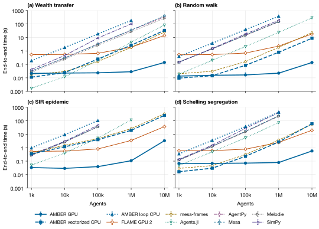
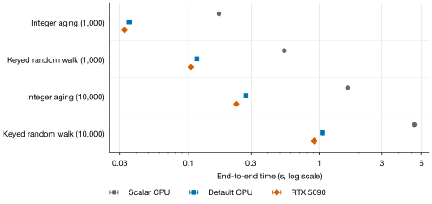

Benchmarks & Performance
========================

AMBER stores the population in a columnar Polars DataFrame and automatically
batches supported ordinary agent methods. The explicit vectorized lane
(``step_vectorized`` / legacy ``step``) runs on GPU via ``model.gpu().run()``
(:doc:`api/gpu`) with device-resident columns when **NVIDIA + CuPy** are
available (not Apple Metal/MPS). Published AMBER (GPU) rows may use an
explicit ``approve_fast_path(evidence)`` label before placement; the label is
**caller provenance**, not a runtime certificate. Batched calibration is
separate (:doc:`api/gpu_ensemble`).

The full suite lives under ``benchmarks/`` (see ``benchmarks/README.md``).
Default CI has no CUDA; re-check GPU claim samples on a GPU host with
``python scripts/run_gpu_claims.py``. Large multi-framework runs use
``python benchmarks/run_all_frameworks.py``.

Matched-rule framework scaling
--------------------------------

The Round 75 campaign compared three AMBER ``0.5.2+fix.11`` execution modes
with AgentPy, Agents.jl, FLAME GPU 2, Melodie, Mesa, mesa-frames, and SimPy.
The four workloads span 1,000 to 10 million agents on a Threadripper PRO
7965WX and RTX 5090. See ``benchmarks/README.md`` for timing samples and
protocol details.

   Medians and min–max whiskers from five timed runs after two warm-ups at
   seed 42. All runs cover 50 steps from construction through final host
   export. Lines end at the last completed population before a budget stop.

AMBER 0.6.0 automatic batching
------------------------------

The release benchmark used the same integer aging and keyed random-walk
declarations on scalar CPU, default CPU, and an RTX 5090. The four cases
covered 1,000 and 10,000 agents over 20 steps. Final agent tables matched
in all 84 runs, including warm-ups.

   Medians and min–max whiskers from six timed runs per case and mode at
   one seed. End-to-end time includes the final host export.

Historical explicit GPU comparison at 10M
------------------------------------------

**Source of truth** (committed JSON, all 10 samples retained — no outlier
trim): ``benchmarks/results/benchmark_results_snapshot_correct_10run_10m.json``
and ``benchmarks/results/summary_table_snapshot_correct_10run_10m.md``.

**Protocol:** NVIDIA RTX 5090; 10M agents; 50 steps; 10 runs; one untimed
warm-up; timed scope = construct + setup + steps + assemble. Implementation
comparison under that protocol — not byte-identical dynamics across frameworks.

================  =============  =============  ==============================
Model             AMBER (GPU)    FLAME GPU 2    Speedup (FLAME / AMBER)
================  =============  =============  ==============================
Wealth            94 ms          194 ms         ~2.05×
Random walk       80 ms          161 ms         ~2.00×
SIR (cell-list)   2.08 s         3.68 s         ~1.77×
Schelling         295 ms         18.7 s         ~63× (setup-inclusive; exploratory)
================  =============  =============  ==============================

- **Wealth / walk / SIR** are the comparable headline class (~1.8–2.1×).
- **Schelling** includes heavy Python-side setup in the FLAME harness; do not
  treat ~63× as a pure step-kernel speedup.
- Multi-framework scale-out charts (Mesa, mesa-frames, Agents.jl, …) under
  ``benchmarks/results/summary_table.md`` are **exploratory** (trimmed means,
  older stack in places). Missing cells (OOM / budget) are not zeros.
- **Reproduce:**
  ``python benchmarks/run_all_frameworks.py --agents 10000000 --steps 50 --runs 10 --frameworks "AMBER (GPU)" "FLAME GPU 2"``
- Production-scale SIR infection draws in the benchmark GPU kernels use a
  **pair-keyed SplitMix64 counter tape** (``global_seed``, step, unordered
  agent pair). The pure-Python reference is locked in
  ``tests/test_sir_counter_tape.py``. This is a benchmark/internal path, not a
  change to the public ``Model.step_vectorized`` API.

The exploratory multi-framework scaling plot is archived in
``benchmarks/README.md`` alongside its own timing protocol.

Calibration throughput
----------------------

For derivative-free calibration, the GPU *ensemble* axis batches ``B``
simulations of ``N`` agents into one device pass
(:func:`ambr.gpu_ensemble.smac_batch_calibrate`). Reported speedups in older
notes (e.g. “hundreds of times vs the slowest peer”) are **task- and
stack-specific** exploratory results — not part of the snapshot_correct 10M
headline table above. Prefer re-running the ensemble benchmarks on your host
before citing absolute throughput.
